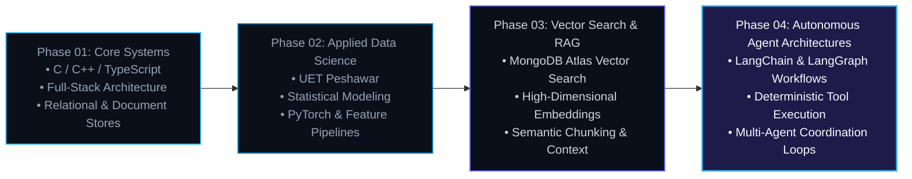

<p align="center">
  
</p>

<p align="center">
  <a href="https://git.io/typing-svg">
    
  </a>
</p>

<p align="center">
  <a href="https://www.linkedin.com/in/hashir-ahmad-25639031b" target="_blank"></a>&nbsp;
  <a href="https://github.com/hashirahmad806" target="_blank"></a>&nbsp;
  <a href="https://x.com/hashirahmad806" target="_blank"></a>&nbsp;
  <a href="https://my-portfolios-sandy.vercel.app/" target="_blank"></a>&nbsp;
  <a href="mailto:hashirahmad809@gmail.com"></a>
</p>

<p align="center">
  
  
  
  
</p>

---

## Technical Trajectory



> *"Modern software engineering is transitioning from deterministic user paths to autonomous cognitive architectures. My focus is engineering agentic systems with verifiable reasoning loops, live tool integration, and high-throughput vector retrieval."*

### Core Systems Engineering Focus:
* **Autonomous Reasoning Loops:** Constructing stateful ReAct and Plan-and-Solve cycles via LangGraph, enabling agents to self-evaluate, catch tool execution failures, and replan dynamically.
* **Event-Driven Vector Pipelines:** Moving beyond static batch embedding ingestion to real-time, CDC-based Atlas vector updates for low-latency contextual intelligence.
* **Context Dynamics & Vector Optimization:** Implementing semantic chunk boundaries, hybrid search (dense embeddings + BM25 keyword matching), and dynamic context compaction.
* **Tool sandboxing & Function Calling:** Interfacing language models with deterministic runtime tools, API clients, and code generation interpreters.

---

## Technical Architecture & Tooling

<table>
  <thead>
    <tr align="left">
      <th width="33%">Cognitive Systems & LLMs</th>
      <th width="33%">Full-Stack Application Layer</th>
      <th width="33%">Data Stores & Infrastructure</th>
    </tr>
  </thead>
  <tbody>
    <tr>
      <td valign="top">
        <p><b>Agent Orchestration</b></p>
        
        
        
        
        <br><br>
        <p><b>Machine Learning & Python</b></p>
        
      </td>
      <td valign="top">
        <p><b>Frontend Architecture</b></p>
        
        <br><br>
        <p><b>Backend & Services</b></p>
        
        
      </td>
      <td valign="top">
        <p><b>Vector & Relational Storage</b></p>
        
        <br><br>
        <p><b>Cloud & DevOps</b></p>
        
      </td>
    </tr>
  </tbody>
</table>

---

## Featured Implementations

<table>
  <tr>
    <td width="50%" valign="top">
      <h3>Production RAG & Vector Intelligence Pipeline</h3>
      <p>An enterprise-grade Retrieval-Augmented Generation pipeline leveraging LangChain, high-dimensional vector embeddings, and MongoDB Vector Search for contextual document intelligence.</p>
      <ul>
        <li><b>Embedding Engine:</b> OpenAI <code>text-embedding-3-small</code> / Hugging Face</li>
        <li><b>Vector Store:</b> MongoDB Atlas Vector Search with Cosine Similarity indexing</li>
        <li><b>Execution:</b> Multi-stage retrieval with conversational memory & context compaction</li>
      </ul>
      <p>
        
        
        
        
      </p>
      <a href="https://github.com/hashirahmad806/Lang_chain_Learning"><b>View System Repository →</b></a>
    </td>
    <td width="50%" valign="top">
      <h3>Interactive Developer Platform</h3>
      <p>Modern personal showcase and interactive hub built for speed, clean UX, and seamless project discovery.</p>
      <ul>
        <li><b>Architecture:</b> Floating island navigation with custom fluid micro-interactions</li>
        <li><b>Telemetry:</b> Resilient direct GitHub API engine with offline cache failover</li>
        <li><b>Stack:</b> React, TypeScript, TailwindCSS, Framer Motion</li>
      </ul>
      <p>
        
        
        
        
      </p>
      <a href="https://my-portfolios-sandy.vercel.app/" target="_blank"><b>Launch Live Interface →</b></a>
    </td>
  </tr>
  <tr>
    <td width="50%" valign="top">
      <h3>Event-Driven Ingestion Engine <sub><i>[In Active Build]</i></sub></h3>
      <p>Real-time CDC (Change Data Capture) pipeline that syncs live database changes directly into vector index chunks for zero-stale RAG.</p>
      <p>
        
        
      </p>
    </td>
    <td width="50%" valign="top">
      <h3>Autonomous Multi-Agent Networks <sub><i>[Next Milestone]</i></sub></h3>
      <p>Agent swarms equipped with deterministic tool execution, state graphs, and self-evaluating critique networks built on LangGraph.</p>
      <p>
        
        
      </p>
    </td>
  </tr>
</table>

---

## Live Telemetry & GitHub Analytics

<p align="center">
  
  &nbsp;&nbsp;
  
</p>

<p align="center">
  
</p>

---

## Contribution Snake

<p align="center">
  <picture>
    <source media="(prefers-color-scheme: dark)" srcset="https://raw.githubusercontent.com/hashirahmad806/hashirahmad806/output/github-contribution-grid-snake-dark.svg">
    <source media="(prefers-color-scheme: light)" srcset="https://raw.githubusercontent.com/hashirahmad806/hashirahmad806/output/github-contribution-grid-snake.svg">
    
  </picture>
</p>

---

## Academic & Engineering Timeline

```
B.E. Data Science — UET Peshawar                                    [2023 – Present]
University of Engineering & Technology, Peshawar, Pakistan
Specialization: Applied Machine Learning, Distributed Data Systems, Cognitive Architectures

Agentic AI & LLM Systems Researcher & Builder                      [Current Focus]
Architecting stateful LangChain / LangGraph systems, Vector RAG pipelines, and tool calling

Full-Stack & Systems Engineering                                    [Foundation]
Engineered high-throughput web applications, microservices, and reactive user interfaces
```

---

## Recent Activity Feed

<!-- RECENT-ACTIVITY:START -->
<!-- Auto-updated by update-readme.yml GitHub Action every 6 hours -->
<!-- RECENT-ACTIVITY:END -->

---

<p align="center">
  
</p>

<p align="center">
  <b>Hashir Ahmad</b> • <a href="https://www.linkedin.com/in/hashir-ahmad-25639031b">LinkedIn</a> • <a href="https://x.com/hashirahmad806">X / Twitter</a> • <a href="mailto:hashirahmad809@gmail.com">Email</a> • <a href="https://my-portfolios-sandy.vercel.app/">Portfolio</a>
</p>
