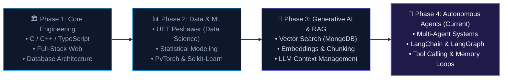

<p align="center">
  
</p>

<p align="center">
  <a href="https://git.io/typing-svg">
    
  </a>
</p>

<p align="center">
  <a href="https://www.linkedin.com/in/hashir-ahmad-25639031b" target="_blank"></a>
  <a href="https://github.com/hashirahmad806" target="_blank"></a>
  <a href="https://x.com/hashirahmad806" target="_blank"></a>
  <a href="https://my-portfolios-sandy.vercel.app/" target="_blank"></a>
  <a href="mailto:hashirahmad809@gmail.com"></a>
</p>

<p align="center">
  
  
  
  
</p>

---

## 🧭 My Journey into the Agentic Frontier



> *"Software is shifting from deterministic code to autonomous cognitive architectures. I am dedicating my engineering journey to building autonomous agents that plan, reason, invoke tools, and solve real-world complexities."*

### 🔬 What I am Deep-Diving Into Right Now:
- **Autonomous Reasoning & Loop Execution:** Implementing ReAct (Reason + Act), Plan-and-Solve, and self-correction loops where models inspect intermediate outputs and pivot.
- **Event-Driven RAG Pipelines:** Transitioning from static batch ingestion to real-time, event-triggered document vectorization (CDC & reactive Atlas pipelines).
- **Context Window Dynamics & Vector Retrieval:** Mastering semantic chunking, multi-stage hybrid search (keyword + dense vector embeddings), and high-throughput vector querying via MongoDB Atlas Vector Search.
- **Agent Tool Ecosystems:** Equipping LLMs with sandboxed computational tools, live database interfaces, external search APIs, and structured function calling.

---

## 🛠️ Tech Stack & Cognitive Tooling

<table>
  <thead>
    <tr align="left">
      <th width="33%">🤖 Agentic & AI Ecosystem</th>
      <th width="33%">🌐 Full-Stack Architecture</th>
      <th width="33%">⚙️ Systems, Cloud & Infra</th>
    </tr>
  </thead>
  <tbody>
    <tr>
      <td valign="top">
        <p><b>Agent Frameworks & LLMs</b></p>
        
        
        
        
        <br><br>
        <p><b>Machine Learning & Data</b></p>
        
      </td>
      <td valign="top">
        <p><b>Frontend & Modern UI</b></p>
        
        <br><br>
        <p><b>Backend & Microservices</b></p>
        
        
      </td>
      <td valign="top">
        <p><b>Vector & Relational Storage</b></p>
        
        <br><br>
        <p><b>Cloud, DevOps & Tools</b></p>
        
      </td>
    </tr>
  </tbody>
</table>

---

## 🚀 Featured Systems & Implementations

<table>
  <tr>
    <td width="50%" valign="top">
      <h3>🧠 Production-Ready RAG & Agent Pipeline</h3>
      <p>An enterprise-grade Retrieval-Augmented Generation pipeline leveraging LangChain, high-dimensional vector embeddings, and MongoDB Vector Search for contextual document intelligence.</p>
      <ul>
        <li><b>Embedding Engine:</b> OpenAI <code>text-embedding-3-small</code> / Hugging Face models</li>
        <li><b>Vector Store:</b> MongoDB Atlas Vector Search with Cosine Similarity indexing</li>
        <li><b>Execution:</b> Multi-stage retrieval with conversational memory & context compaction</li>
      </ul>
      <p>
        
        
        
        
      </p>
      <a href="https://github.com/hashirahmad806/Lang_chain_Learning"><b>⚡ Explore Repository →</b></a>
    </td>
    <td width="50%" valign="top">
      <h3>🌐 Interactive Developer Portfolio</h3>
      <p>Modern personal showcase and interactive hub built for speed, clean UX, and seamless project discovery.</p>
      <ul>
        <li><b>Responsive Design:</b> Clean aesthetic with fluid typography and interactive elements</li>
        <li><b>Deployment:</b> Continuous deployment on Vercel edge networks</li>
        <li><b>Stack:</b> React, TypeScript, TailwindCSS, Vite</li>
      </ul>
      <p>
        
        
        
        
      </p>
      <a href="https://my-portfolios-sandy.vercel.app/" target="_blank"><b>🌍 Live Interactive Demo →</b></a>
    </td>
  </tr>
  <tr>
    <td width="50%" valign="top">
      <h3>⚡ Real-Time Ingestion Engine <sub><i>(In Development)</i></sub></h3>
      <p>Event-driven CDC (Change Data Capture) pipeline that syncs live database changes directly into vector index chunks for zero-stale RAG.</p>
      <p>
        
        
      </p>
    </td>
    <td width="50%" valign="top">
      <h3>🤖 Autonomous Multi-Agent Workflows <sub><i>(Next Milestone)</i></sub></h3>
      <p>Agent swarms equipped with deterministic tool execution, state graphs, and self-evaluating critique networks built on LangGraph.</p>
      <p>
        
        
      </p>
    </td>
  </tr>
</table>

---

## 📊 Live Telemetry & GitHub Analytics

<p align="center">
  
  &nbsp;&nbsp;
  
</p>

<p align="center">
  
</p>

---

## 🐍 Dynamic Contribution Snake

<p align="center">
  <picture>
    <source media="(prefers-color-scheme: dark)" srcset="https://raw.githubusercontent.com/hashirahmad806/hashirahmad806/output/github-contribution-grid-snake-dark.svg">
    <source media="(prefers-color-scheme: light)" srcset="https://raw.githubusercontent.com/hashirahmad806/hashirahmad806/output/github-contribution-grid-snake.svg">
    
  </picture>
</p>

---

## 🎓 Academic & Engineering Timeline

```
🎓  B.E. Data Science — UET Peshawar                                    [2023 – Present]
    University of Engineering & Technology, Peshawar, Pakistan
    Focus: Applied Machine Learning, Distributed Data Systems, Cognitive Architectures

🚀  Agentic AI & LLM Systems Researcher & Builder                      [Present Focus]
    Designing autonomous LangChain / LangGraph systems, Vector RAG pipelines, and tools

💻  Full-Stack & Systems Engineering                                    [Foundation]
    Developed enterprise web applications, REST/GraphQL microservices, and reactive UIs
```

---

## 📰 Recent Activity Feed

<!-- RECENT-ACTIVITY:START -->
<!-- Auto-updated by update-readme.yml GitHub Action every 6 hours -->
<!-- RECENT-ACTIVITY:END -->

---

<p align="center">
  
</p>

<p align="center">
  <i>💡 "The best way to predict the future is to engineer the agents that build it."</i><br>
  <b>Connect with me:</b> <a href="https://www.linkedin.com/in/hashir-ahmad-25639031b">LinkedIn</a> • <a href="https://x.com/hashirahmad806">X / Twitter</a> • <a href="mailto:hashirahmad809@gmail.com">Email</a>
</p>
